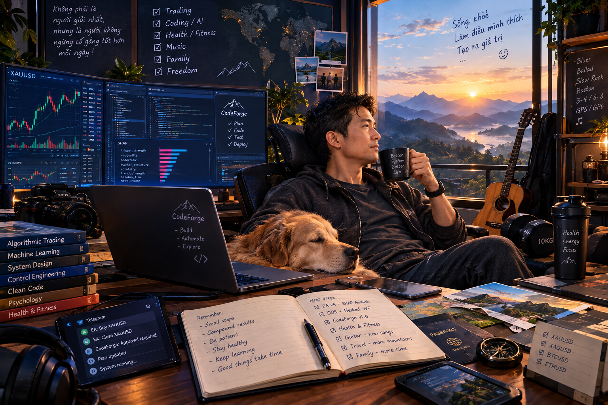

### Building autonomous systems. Engineering controlled evolution.

 

---

<h3>🇬🇧 English</h3>

 

# Hi, I'm Dien Vu 👋

### AI Engineer · Autonomous Agent Systems · Quantitative Research

**Building AI systems that don't just generate solutions — they engineer, verify, and improve them.**

I am an independent developer interested in AI engineering, autonomous software development, machine learning, quantitative research, and reliable intelligent systems.

My primary focus is **CodeForge-v2** — an ongoing effort to build a governed autonomous software engineering agent and, ultimately, a self-evolving engineering system.

---

## 🧠 What I'm Building

### CodeForge-v2 — Toward Governed Autonomous Engineering

**My main project and primary engineering focus.**

🔗 **[Explore CodeForge-v2](https://github.com/Dienvu1008/CodeForge-v2)**

I am building an autonomous software engineering agent designed to go beyond code generation.

The long-term vision is a system that can understand engineering tasks, investigate codebases, plan implementations, modify code, execute tools, validate results, recover from failures, and improve its own capabilities under explicit governance.

The central idea is simple:

> **LLMs propose. Deterministic systems decide authority. Verification determines completion.**

Rather than relying entirely on an LLM's judgment, CodeForge-v2 is built around a deterministic governance kernel that controls how the agent interacts with its environment.

**Key engineering principles:**

- 🛡️ **Governed autonomy** — AI capabilities operate within explicit policies, permissions, approval boundaries, and execution limits.
- ⚙️ **Deterministic enforcement** — Critical execution decisions belong to runtime components, not unrestricted model-generated instructions.
- 🧩 **Task and execution integrity** — Explicit task graphs, state transitions, checkpoints, and controlled tool execution.
- 🔍 **Evidence-based verification** — Distinguishing a model's claim of success from results supported by actual execution and verification evidence.
- 📜 **Observability and provenance** — Recording execution events and relevant evidence to support debugging, auditing, and recovery.
- 🔄 **Controlled self-evolution** — Exploring how an agent can evaluate and improve its own engineering capabilities without bypassing its governance boundaries.

The long-term objective is to evolve CodeForge from an autonomous coding agent into a **governed, self-improving engineering system**.

Self-evolution is a research and development direction, not a claim that unrestricted or fully autonomous self-improvement has already been achieved.

---

## 🔬 My Engineering Philosophy

I am particularly interested in a fundamental question:

**How can we make AI agents more capable without making them less controllable?**

My approach emphasizes the engineering system surrounding the model, not just the intelligence of the model itself.

| Principle | How I approach it |
|---|---|
| Separation of authority | Models propose actions; deterministic runtime components enforce permissions and constraints. |
| Verification over confidence | Successful completion requires evidence, not merely a convincing model response. |
| Explicit invariants | Important safety and correctness properties should be enforced and tested. |
| Bounded autonomy | Tool access, execution, retries, resource consumption, and approvals need defined boundaries. |
| Observable execution | Agent behavior should produce useful operational evidence for debugging and evaluation. |
| Evidence-driven evolution | Improvements should be evaluated against measurable outcomes rather than assumed to be beneficial. |
| Incremental engineering | Build practical, testable capabilities before introducing additional architectural complexity. |

I am interested in the intersection of autonomous agents, software architecture, runtime governance, verification-driven development, and self-improving AI systems.

---

## 🚀 Featured Projects

### 1. ⚒️ CodeForge-v2

**Governed Autonomous Software Engineering Agent**

My primary project explores the engineering foundations required to make autonomous coding agents more reliable and controllable.

Areas of focus include:

- Agent orchestration and tool execution.
- Deterministic runtime governance.
- Task graphs and explicit state management.
- Policy enforcement and human approval.
- Verification and completion gates.
- Execution history, observability, and recovery.
- A long-term architecture for controlled self-evolution.

**Vision:** Move from AI-assisted programming toward autonomous engineering with explicit control, verifiable outcomes, and a foundation for continuous improvement.

### 2. 📈 Quant-Trading-2

**Quantitative Research · Machine Learning · Algorithmic Trading**

This project reflects my interest in applying data analysis and machine learning to quantitative trading research.

My work in this area involves exploring the relationship between market data, trading strategies, statistical evidence, and systematic evaluation.

Key areas of interest:

- Financial time-series analysis.
- Machine learning for trading research.
- Strategy evaluation and backtesting.
- Out-of-sample validation.
- Walk-forward testing and robustness analysis.
- Risk management and evidence-based strategy selection.
- Reducing overfitting and misleading performance estimates.

**Research principle:** A strategy that performs well on historical data is a hypothesis to investigate, not proof of a durable trading edge.

### 3. 🗓️ My Time Manager

**Personal Productivity · Flutter · Dart · AI-Assisted Workflows**

An exploration of a personal productivity system that brings planning, knowledge management, habits, and AI-assisted workflows into one application.

The broader vision includes:

- Notes and personal knowledge management.
- Goals, planning, and time allocation.
- Habit tracking and reminders.
- Learning and AI-assisted content generation.
- A deterministic application core with optional AI capabilities.

This project explores another side of my engineering interests: translating complex workflows into practical software while keeping core behavior predictable and maintainable.

---

## 🛠️ Technical Interests

### AI & Intelligent Systems

- Autonomous AI agents and agent harnesses
- LLM tool use and orchestration
- Local LLMs and model integration
- Retrieval and context engineering
- Agent evaluation and benchmarking
- Controlled self-improvement
- AI-assisted software engineering

### Software Engineering

- TypeScript and Node.js
- Python and machine learning
- Dart and Flutter
- Software architecture and modular design
- State machines and deterministic systems
- Design by Contract
- Invariant-driven development
- Verification-driven development
- Runtime governance and execution safety

### Quantitative Research

- Data analysis and machine learning
- Algorithmic trading
- MQL5 and MetaTrader 5
- Backtesting and walk-forward evaluation
- Statistical validation
- Strategy robustness and risk management

### Development Environments

- Git and GitHub
- Visual Studio Code
- Ollama and local AI workflows
- Windows and Linux environments
- Automated testing and development tooling

---

## 🧭 What I'm Exploring Next

My long-term research direction is to understand how an AI engineering system can improve itself without sacrificing reliability or control.

I am particularly interested in the following areas:

**01 — Better Engineering Intelligence**  
Improve repository understanding, task decomposition, context selection, planning, and failure diagnosis so agents can solve meaningful engineering tasks more effectively.

**02 — Reliable Autonomous Execution**  
Build stronger feedback loops around tool execution, verification, failure recovery, and task completion.

**03 — Evidence-Based Self-Improvement**  
Investigate how an agent can identify capability gaps, formulate improvement hypotheses, run controlled experiments, and retain improvements only when evaluation supports them.

**04 — Efficient AI Infrastructure**  
Explore model routing, local inference, context efficiency, retrieval, and other approaches that improve practical capability under limited computational resources.

**05 — Governed Self-Evolving Systems**  
Develop the architectural foundations for an agent that can improve its own components while preserving explicit authority boundaries, testable invariants, and independent verification.

My approach is to establish reliable engineering capabilities first, then expand autonomy as the system earns it through evidence.

---

## 💡 How I Think About AI Agents

I believe the next step in AI engineering is not simply giving models more tools or longer contexts.

It is building systems in which intelligence, execution, verification, and authority are deliberately separated.

An agent should be able to propose a sophisticated solution without automatically receiving permission to execute it. It should be able to report progress without being allowed to fabricate successful completion. And it should be able to propose improvements to itself without unilaterally redefining the rules that govern those improvements.

That is the direction I am exploring with CodeForge-v2.

**The goal is not autonomy at any cost. It is increasing capability while preserving control.**

---

## 🤝 Let's Connect

I'm interested in connecting with people working on:

- AI engineering and autonomous coding agents.
- Agent harnesses and runtime architecture.
- AI safety engineering and controlled autonomy.
- Self-improving systems and agent evaluation.
- Machine learning and quantitative research.
- Open-source engineering tools.

If you're exploring similar problems, I'd be happy to exchange ideas and learn from your work.

### Build intelligently. Verify rigorously. Evolve responsibly.

**Thanks for visiting my profile!** ⭐

---

<h3>🇩🇪 Deutsch</h3>

 

# Hallo, ich bin Dien Vu 👋

### AI-Ingenieur · Autonome Agentensysteme · Quantitative Forschung

**Ich baue KI-Systeme, die nicht nur Lösungen generieren — sondern sie entwerfen, verifizieren und verbessern.**

Ich bin ein unabhängiger Entwickler mit Interesse an KI-Engineering, autonomer Softwareentwicklung, maschinellem Lernen, quantitativer Forschung und zuverlässigen intelligenten Systemen.

Mein aktueller Schwerpunkt ist **CodeForge-v2** — ein laufendes Vorhaben zum Aufbau eines gesteuerten autonomen Software-Engineering-Agenten und langfristig eines selbstentwickelnden Engineering-Systems.

---

## 🧠 Woran ich arbeite

### CodeForge-v2 — Auf dem Weg zu gesteuertem autonomem Engineering

**Mein Hauptprojekt und technischer Schwerpunkt.**

🔗 **[CodeForge-v2 erkunden](https://github.com/Dienvu1008/CodeForge-v2)**

Ich baue einen autonomen Software-Engineering-Agenten, der über reine Codegenerierung hinausgeht.

Die langfristige Vision ist ein System, das Engineering-Aufgaben verstehen, Codebasen untersuchen, Implementierungen planen, Code ändern, Werkzeuge ausführen, Ergebnisse validieren, von Fehlern wiederherstellen und seine eigenen Fähigkeiten unter expliziter Governance verbessern kann.

Die zentrale Idee ist einfach:

> **LLMs schlagen vor. Deterministische Systeme entscheiden über Autorität. Verifikation bestimmt den Abschluss.**

Anstatt sich vollständig auf das Urteil eines LLMs zu verlassen, basiert CodeForge-v2 auf einem deterministischen Governance-Kernel, der kontrolliert, wie der Agent mit seiner Umgebung interagiert.

**Zentrale Engineering-Prinzipien:**

- 🛡️ **Gesteuerte Autonomie** — KI-Fähigkeiten operieren innerhalb klarer Richtlinien, Berechtigungen, Genehmigungsgrenzen und Ausführungsbeschränkungen.
- ⚙️ **Deterministische Durchsetzung** — Kritische Ausführungsentscheidungen liegen bei Runtime-Komponenten, nicht bei uneingeschränkten modellgenerierten Anweisungen.
- 🧩 **Aufgaben- und Ausführungsintegrität** — Explizite Task-Graphen, Zustandsübergänge, Checkpoints und kontrollierte Werkzeugausführung.
- 🔍 **Evidenzbasierte Verifikation** — Unterscheidung zwischen der Erfolgsbehauptung eines Modells und Ergebnissen, die durch tatsächliche Ausführung und Verifikationsbeweise gestützt werden.
- 📜 **Beobachtbarkeit und Provenienz** — Aufzeichnung von Ausführungsereignissen und relevanten Beweisen zur Unterstützung von Debugging, Auditing und Recovery.
- 🔄 **Kontrollierte Selbstentwicklung** — Erforschung, wie ein Agent seine eigenen Engineering-Fähigkeiten bewerten und verbessern kann, ohne seine Governance-Grenzen zu überschreiten.

Das langfristige Ziel ist es, CodeForge von einem autonomen Coding-Agenten zu einem **gesteuerten, selbstverbessernden Engineering-System** weiterzuentwickeln.

Selbstentwicklung ist eine Forschungs- und Entwicklungsrichtung, keine Behauptung, dass uneingeschränkte oder vollständig autonome Selbstverbesserung bereits erreicht wurde.

---

## 🔬 Meine Engineering-Philosophie

Mich interessiert besonders eine grundlegende Frage:

**Wie können wir KI-Agenten fähiger machen, ohne sie weniger kontrollierbar zu machen?**

Mein Ansatz betont das Engineering-System rund um das Modell, nicht nur die Intelligenz des Modells selbst.

| Prinzip | Mein Ansatz |
|---|---|
| Trennung der Autorität | Modelle schlagen Aktionen vor; deterministische Runtime-Komponenten setzen Berechtigungen und Einschränkungen durch. |
| Verifikation vor Vertrauen | Erfolgreicher Abschluss erfordert Beweise, nicht nur eine überzeugende Modellantwort. |
| Explizite Invarianten | Wichtige Sicherheits- und Korrektheitseigenschaften sollten durchgesetzt und getestet werden. |
| Begrenzte Autonomie | Werkzeugzugriff, Ausführung, Wiederholungen, Ressourcenverbrauch und Genehmigungen brauchen definierte Grenzen. |
| Beobachtbare Ausführung | Agentenverhalten sollte nützliche operative Beweise für Debugging und Evaluation erzeugen. |
| Evidenzgetriebene Evolution | Verbesserungen sollten anhand messbarer Ergebnisse bewertet werden, statt als vorteilhaft angenommen zu werden. |
| Inkrementelles Engineering | Praktische, testbare Fähigkeiten aufbauen, bevor zusätzliche architektonische Komplexität eingeführt wird. |

Ich interessiere mich für die Schnittstelle von autonomen Agenten, Softwarearchitektur, Runtime-Governance, verifikationsgetriebenem Development und selbstverbessernden KI-Systemen.

---

## 🚀 Ausgewählte Projekte

### 1. ⚒️ CodeForge-v2

**Gesteuerter autonomer Software-Engineering-Agent**

Mein Hauptprojekt erforscht die Engineering-Grundlagen, die notwendig sind, um autonome Coding-Agenten zuverlässiger und kontrollierbarer zu machen.

Schwerpunkte sind unter anderem:

- Agenten-Orchestrierung und Werkzeugausführung.
- Deterministische Runtime-Governance.
- Task-Graphen und explizites Zustandsmanagement.
- Richtliniendurchsetzung und menschliche Genehmigung.
- Verifikations- und Abschluss-Gates.
- Ausführungshistorie, Beobachtbarkeit und Recovery.
- Eine langfristige Architektur für kontrollierte Selbstentwicklung.

**Vision:** Von KI-unterstützter Programmierung hin zu autonomem Engineering mit expliziter Kontrolle, verifizierbaren Ergebnissen und einer Grundlage für kontinuierliche Verbesserung.

### 2. 📈 Quant-Trading-2

**Quantitative Forschung · Maschinelles Lernen · Algorithmischer Handel**

Dieses Projekt spiegelt mein Interesse wider, Datenanalyse und maschinelles Lernen auf quantitative Handelsforschung anzuwenden.

Meine Arbeit in diesem Bereich umfasst die Erforschung der Beziehung zwischen Marktdaten, Handelsstrategien, statistischen Beweisen und systematischer Evaluation.

Zentrale Interessensgebiete:

- Analyse finanzieller Zeitreihen.
- Maschinelles Lernen für Handelsforschung.
- Strategieevaluation und Backtesting.
- Out-of-Sample-Validierung.
- Walk-Forward-Tests und Robustheitsanalyse.
- Risikomanagement und evidenzbasierte Strategieauswahl.
- Reduktion von Overfitting und irreführenden Performance-Schätzungen.

**Forschungsprinzip:** Eine Strategie, die auf historischen Daten gut abschneidet, ist eine zu untersuchende Hypothese — kein Beweis für einen dauerhaften Handelsvorteil.

### 3. 🗓️ My Time Manager

**Persönliche Produktivität · Flutter · Dart · KI-unterstützte Workflows**

Eine Erkundung eines persönlichen Produktivitätssystems, das Planung, Wissensmanagement, Gewohnheiten und KI-unterstützte Workflows in einer Anwendung vereint.

Die breitere Vision umfasst:

- Notizen und persönliches Wissensmanagement.
- Ziele, Planung und Zeitallokation.
- Habit-Tracking und Erinnerungen.
- Lernen und KI-unterstützte Inhaltserstellung.
- Einen deterministischen Anwendungskern mit optionalen KI-Fähigkeiten.

Dieses Projekt erkundet eine weitere Seite meiner Engineering-Interessen: komplexe Workflows in praktische Software zu übersetzen und dabei das Kernverhalten vorhersagbar und wartbar zu halten.

---

## 🛠️ Technische Interessen

### KI & Intelligente Systeme

- Autonome KI-Agenten und Agent-Harnesses
- LLM-Tool-Nutzung und Orchestrierung
- Lokale LLMs und Modellintegration
- Retrieval und Context Engineering
- Agentenevaluation und Benchmarking
- Kontrollierte Selbstverbesserung
- KI-unterstütztes Software-Engineering

### Software Engineering

- TypeScript und Node.js
- Python und maschinelles Lernen
- Dart und Flutter
- Softwarearchitektur und modulares Design
- Zustandsmaschinen und deterministische Systeme
- Design by Contract
- Invarianten-getriebenes Development
- Verifikations-getriebenes Development
- Runtime-Governance und Ausführungssicherheit

### Quantitative Forschung

- Datenanalyse und maschinelles Lernen
- Algorithmischer Handel
- MQL5 und MetaTrader 5
- Backtesting und Walk-Forward-Evaluation
- Statistische Validierung
- Strategierobustheit und Risikomanagement

### Entwicklungsumgebungen

- Git und GitHub
- Visual Studio Code
- Ollama und lokale KI-Workflows
- Windows- und Linux-Umgebungen
- Automatisiertes Testen und Entwicklungswerkzeuge

---

## 🧭 Was ich als Nächstes erkunde

Meine langfristige Forschungsrichtung ist zu verstehen, wie ein KI-Engineering-System sich selbst verbessern kann, ohne Zuverlässigkeit oder Kontrolle zu opfern.

Besonders interessieren mich folgende Bereiche:

**01 — Bessere Engineering-Intelligenz**  
Verbesserung des Repository-Verständnisses, der Aufgabenzerlegung, der Kontextauswahl, der Planung und der Fehlerdiagnose, damit Agenten sinnvolle Engineering-Aufgaben effektiver lösen können.

**02 — Zuverlässige autonome Ausführung**  
Aufbau stärkerer Feedback-Schleifen rund um Werkzeugausführung, Verifikation, Fehler-Recovery und Aufgabenabschluss.

**03 — Evidenzbasierte Selbstverbesserung**  
Untersuchung, wie ein Agent Fähigkeitslücken identifizieren, Verbesserungs-Hypothesen formulieren, kontrollierte Experimente durchführen und Verbesserungen nur behalten kann, wenn die Evaluation sie stützt.

**04 — Effiziente KI-Infrastruktur**  
Erforschung von Modell-Routing, lokaler Inferenz, Kontexteffizienz, Retrieval und anderen Ansätzen, die praktische Fähigkeiten unter begrenzten Rechenressourcen verbessern.

**05 — Gesteuerte selbstentwickelnde Systeme**  
Entwicklung der architektonischen Grundlagen für einen Agenten, der seine eigenen Komponenten verbessern kann und dabei explizite Autoritätsgrenzen, testbare Invarianten und unabhängige Verifikation bewahrt.

Mein Ansatz ist, zuerst zuverlässige Engineering-Fähigkeiten aufzubauen und die Autonomie erst dann zu erweitern, wenn das System sie durch Beweise verdient hat.

---

## 💡 Wie ich über KI-Agenten denke

Ich glaube, der nächste Schritt im KI-Engineering besteht nicht einfach darin, Modellen mehr Werkzeuge oder längere Kontexte zu geben.

Es geht darum, Systeme zu bauen, in denen Intelligenz, Ausführung, Verifikation und Autorität bewusst getrennt sind.

Ein Agent sollte in der Lage sein, eine anspruchsvolle Lösung vorzuschlagen, ohne automatisch die Erlaubnis zu erhalten, sie auszuführen. Er sollte Fortschritte berichten können, ohne erfolgreichen Abschluss erfinden zu dürfen. Und er sollte Verbesserungen an sich selbst vorschlagen können, ohne einseitig die Regeln neu zu definieren, die diese Verbesserungen regeln.

Das ist die Richtung, die ich mit CodeForge-v2 erkunde.

**Das Ziel ist nicht Autonomie um jeden Preis. Es ist die Steigerung von Fähigkeiten bei gleichzeitiger Bewahrung von Kontrolle.**

---

## 🤝 Lass uns vernetzen

Ich interessiere mich für den Austausch mit Menschen, die an folgenden Themen arbeiten:

- KI-Engineering und autonome Coding-Agenten.
- Agent-Harnesses und Runtime-Architektur.
- KI-Sicherheitsengineering und kontrollierte Autonomie.
- Selbstverbessernde Systeme und Agentenevaluation.
- Maschinelles Lernen und quantitative Forschung.
- Open-Source-Engineering-Werkzeuge.

Wenn du an ähnlichen Problemen arbeitest, würde ich mich freuen, Ideen auszutauschen und von deiner Arbeit zu lernen.

### Intelligent bauen. Rigoros verifizieren. Verantwortungsvoll entwickeln.

**Danke für deinen Besuch auf meinem Profil!** ⭐

---

<h3>🇻🇳 Tiếng Việt</h3>

 

# Xin chào, tôi là Điền Vũ 👋

### Kỹ sư AI · Hệ thống Agent Tự chủ · Nghiên cứu Định lượng

**Xây dựng các hệ thống AI không chỉ tạo ra giải pháp — mà còn thiết kế, xác minh và cải thiện chúng.**

Tôi là một lập trình viên độc lập quan tâm đến kỹ thuật AI, phát triển phần mềm tự chủ, học máy, nghiên cứu định lượng và các hệ thống thông minh đáng tin cậy.

Trọng tâm chính của tôi hiện nay là **CodeForge-v2** — một nỗ lực đang diễn ra nhằm xây dựng một agent kỹ thuật phần mềm tự chủ được quản trị, và hướng tới một hệ thống kỹ thuật có khả năng tự tiến hóa.

---

## 🧠 Tôi đang xây dựng gì

### CodeForge-v2 — Hướng tới Kỹ thuật Tự chủ được Quản trị

**Đây là dự án chính và trọng tâm kỹ thuật của tôi.**

🔗 **[Khám phá CodeForge-v2](https://github.com/Dienvu1008/CodeForge-v2)**

Tôi đang xây dựng một agent kỹ thuật phần mềm tự chủ, được thiết kế để vượt xa việc chỉ sinh mã.

Tầm nhìn dài hạn là một hệ thống có thể hiểu nhiệm vụ kỹ thuật, khảo sát codebase, lập kế hoạch triển khai, sửa đổi mã, thực thi công cụ, xác thực kết quả, phục hồi từ lỗi và cải thiện năng lực của chính nó dưới sự quản trị rõ ràng.

Ý tưởng trung tâm rất đơn giản:

> **LLM đề xuất. Hệ thống xác định đưa ra quyết định thẩm quyền. Việc xác minh quyết định sự hoàn thành.**

Thay vì phụ thuộc hoàn toàn vào phán đoán của LLM, CodeForge-v2 được xây dựng xung quanh một kernel quản trị xác định, kiểm soát cách agent tương tác với môi trường.

**Các nguyên tắc kỹ thuật cốt lõi:**

- 🛡️ **Tự chủ có quản trị** — Năng lực AI hoạt động trong các chính sách, quyền hạn, ranh giới phê duyệt và giới hạn thực thi rõ ràng.
- ⚙️ **Thực thi xác định** — Các quyết định thực thi quan trọng thuộc về các thành phần runtime, không phải các chỉ dẫn không bị ràng buộc do mô hình tạo ra.
- 🧩 **Tính toàn vẹn của nhiệm vụ và thực thi** — Đồ thị nhiệm vụ tường minh, chuyển trạng thái, checkpoint và thực thi công cụ được kiểm soát.
- 🔍 **Xác minh dựa trên bằng chứng** — Phân biệt giữa tuyên bố thành công của mô hình với kết quả được hỗ trợ bởi bằng chứng thực thi và xác minh thực tế.
- 📜 **Khả năng quan sát và nguồn gốc** — Ghi lại các sự kiện thực thi và bằng chứng liên quan để hỗ trợ gỡ lỗi, kiểm toán và phục hồi.
- 🔄 **Tự tiến hóa có kiểm soát** — Nghiên cứu cách một agent có thể đánh giá và cải thiện năng lực kỹ thuật của chính nó mà không vượt qua ranh giới quản trị.

Mục tiêu dài hạn là phát triển CodeForge từ một agent lập trình tự chủ thành một **hệ thống kỹ thuật tự cải thiện được quản trị**.

Tự tiến hóa là một hướng nghiên cứu và phát triển, không phải tuyên bố rằng khả năng tự cải thiện không hạn chế hoặc hoàn toàn tự chủ đã đạt được.

---

## 🔬 Triết lý Kỹ thuật của tôi

Tôi đặc biệt quan tâm đến một câu hỏi nền tảng:

**Làm thế nào để làm cho các agent AI mạnh mẽ hơn mà không làm chúng kém kiểm soát hơn?**

Cách tiếp cận của tôi nhấn mạnh vào hệ thống kỹ thuật bao quanh mô hình, chứ không chỉ trí thông minh của bản thân mô hình.

| Nguyên tắc | Cách tôi tiếp cận |
|---|---|
| Tách biệt thẩm quyền | Mô hình đề xuất hành động; các thành phần runtime xác định thực thi quyền hạn và ràng buộc. |
| Xác minh hơn sự tự tin | Việc hoàn thành thành công đòi hỏi bằng chứng, không chỉ một phản hồi mô hình thuyết phục. |
| Bất biến tường minh | Các thuộc tính an toàn và đúng đắn quan trọng cần được thực thi và kiểm thử. |
| Tự chủ có giới hạn | Quyền truy cập công cụ, thực thi, thử lại, tiêu thụ tài nguyên và phê duyệt cần có ranh giới rõ ràng. |
| Thực thi có thể quan sát | Hành vi của agent cần tạo ra bằng chứng vận hành hữu ích cho việc gỡ lỗi và đánh giá. |
| Tiến hóa dựa trên bằng chứng | Các cải tiến cần được đánh giá dựa trên kết quả đo lường được, thay vì giả định là có lợi. |
| Kỹ thuật gia tăng | Xây dựng các năng lực thực tế, có thể kiểm thử trước khi đưa thêm độ phức tạp kiến trúc. |

Tôi quan tâm đến giao điểm giữa agent tự chủ, kiến trúc phần mềm, quản trị runtime, phát triển dựa trên xác minh và các hệ thống AI tự cải thiện.

---

## 🚀 Các dự án nổi bật

### 1. ⚒️ CodeForge-v2

**Agent Kỹ thuật Phần mềm Tự chủ được Quản trị**

Dự án chính của tôi khám phá những nền tảng kỹ thuật cần thiết để làm cho các agent lập trình tự chủ trở nên đáng tin cậy và có thể kiểm soát hơn.

Các lĩnh vực tập trung bao gồm:

- Điều phối agent và thực thi công cụ.
- Quản trị runtime xác định.
- Đồ thị nhiệm vụ và quản lý trạng thái tường minh.
- Thực thi chính sách và phê duyệt của con người.
- Cổng xác minh và hoàn thành.
- Lịch sử thực thi, khả năng quan sát và phục hồi.
- Kiến trúc dài hạn cho sự tự tiến hóa có kiểm soát.

**Tầm nhìn:** Chuyển từ lập trình được AI hỗ trợ sang kỹ thuật tự chủ với sự kiểm soát rõ ràng, kết quả có thể xác minh và nền tảng cho sự cải thiện liên tục.

### 2. 📈 Quant-Trading-2

**Nghiên cứu Định lượng · Học máy · Giao dịch Thuật toán**

Dự án này phản ánh sự quan tâm của tôi trong việc áp dụng phân tích dữ liệu và học máy vào nghiên cứu giao dịch định lượng.

Công việc của tôi trong lĩnh vực này bao gồm khám phá mối quan hệ giữa dữ liệu thị trường, chiến lược giao dịch, bằng chứng thống kê và đánh giá có hệ thống.

Các lĩnh vực quan tâm chính:

- Phân tích chuỗi thời gian tài chính.
- Học máy cho nghiên cứu giao dịch.
- Đánh giá chiến lược và backtesting.
- Xác thực ngoài mẫu.
- Kiểm thử walk-forward và phân tích độ vững chắc.
- Quản lý rủi ro và lựa chọn chiến lược dựa trên bằng chứng.
- Giảm overfitting và các ước lượng hiệu suất gây hiểu nhầm.

**Nguyên tắc nghiên cứu:** Một chiến lược hoạt động tốt trên dữ liệu lịch sử chỉ là một giả thuyết cần điều tra, chứ không phải bằng chứng của lợi thế giao dịch bền vững.

### 3. 🗓️ My Time Manager

**Năng suất Cá nhân · Flutter · Dart · Quy trình làm việc được AI hỗ trợ**

Một sự khám phá về hệ thống năng suất cá nhân kết hợp lập kế hoạch, quản lý tri thức, thói quen và các quy trình được AI hỗ trợ trong một ứng dụng duy nhất.

Tầm nhìn rộng hơn bao gồm:

- Ghi chú và quản lý tri thức cá nhân.
- Mục tiêu, lập kế hoạch và phân bổ thời gian.
- Theo dõi thói quen và nhắc nhở.
- Học tập và tạo nội dung được AI hỗ trợ.
- Lõi ứng dụng xác định với các năng lực AI tùy chọn.

Dự án này khám phá một khía cạnh khác trong sự quan tâm kỹ thuật của tôi: chuyển các quy trình phức tạp thành phần mềm thực tế trong khi vẫn giữ hành vi cốt lõi có thể dự đoán và dễ bảo trì.

---

## 🛠️ Lĩnh vực kỹ thuật quan tâm

### AI & Hệ thống Thông minh

- Agent AI tự chủ và agent harness
- Sử dụng công cụ LLM và điều phối
- LLM cục bộ và tích hợp mô hình
- Retrieval và kỹ thuật ngữ cảnh
- Đánh giá và benchmark agent
- Tự cải thiện có kiểm soát
- Kỹ thuật phần mềm được AI hỗ trợ

### Kỹ thuật Phần mềm

- TypeScript và Node.js
- Python và học máy
- Dart và Flutter
- Kiến trúc phần mềm và thiết kế module
- Máy trạng thái và hệ thống xác định
- Design by Contract
- Phát triển dựa trên bất biến
- Phát triển dựa trên xác minh
- Quản trị runtime và an toàn thực thi

### Nghiên cứu Định lượng

- Phân tích dữ liệu và học máy
- Giao dịch thuật toán
- MQL5 và MetaTrader 5
- Backtesting và đánh giá walk-forward
- Xác thực thống kê
- Độ vững chắc chiến lược và quản lý rủi ro

### Môi trường Phát triển

- Git và GitHub
- Visual Studio Code
- Ollama và quy trình AI cục bộ
- Môi trường Windows và Linux
- Kiểm thử tự động và công cụ phát triển

---

## 🧭 Những gì tôi đang khám phá tiếp theo

Hướng nghiên cứu dài hạn của tôi là hiểu cách một hệ thống kỹ thuật AI có thể tự cải thiện mà không hy sinh độ tin cậy hoặc khả năng kiểm soát.

Tôi đặc biệt quan tâm đến các lĩnh vực sau:

**01 — Trí tuệ Kỹ thuật tốt hơn**  
Cải thiện khả năng hiểu repository, phân rã nhiệm vụ, lựa chọn ngữ cảnh, lập kế hoạch và chẩn đoán lỗi để agent có thể giải quyết các nhiệm vụ kỹ thuật có ý nghĩa một cách hiệu quả hơn.

**02 — Thực thi Tự chủ Đáng tin cậy**  
Xây dựng vòng phản hồi mạnh hơn xung quanh thực thi công cụ, xác minh, phục hồi lỗi và hoàn thành nhiệm vụ.

**03 — Tự cải thiện dựa trên Bằng chứng**  
Nghiên cứu cách một agent có thể xác định khoảng trống năng lực, đưa ra giả thuyết cải tiến, chạy thí nghiệm có kiểm soát và chỉ giữ lại những cải tiến khi đánh giá hỗ trợ chúng.

**04 — Hạ tầng AI Hiệu quả**  
Khám phá định tuyến mô hình, suy luận cục bộ, hiệu quả ngữ cảnh, retrieval và các cách tiếp cận khác nhằm cải thiện năng lực thực tế trong điều kiện tài nguyên tính toán hạn chế.

**05 — Hệ thống Tự tiến hóa được Quản trị**  
Phát triển nền tảng kiến trúc cho một agent có thể cải thiện các thành phần của chính nó trong khi vẫn bảo toàn ranh giới thẩm quyền rõ ràng, các bất biến có thể kiểm thử và xác minh độc lập.

Cách tiếp cận của tôi là thiết lập các năng lực kỹ thuật đáng tin cậy trước, sau đó mở rộng quyền tự chủ khi hệ thống chứng minh được điều đó thông qua bằng chứng.

---

## 💡 Cách tôi suy nghĩ về Agent AI

Tôi tin rằng bước tiếp theo trong kỹ thuật AI không chỉ đơn giản là cung cấp cho mô hình nhiều công cụ hơn hoặc ngữ cảnh dài hơn.

Mà là xây dựng các hệ thống trong đó trí tuệ, thực thi, xác minh và thẩm quyền được tách biệt một cách có chủ đích.

Một agent cần có khả năng đề xuất một giải pháp tinh vi mà không tự động nhận được quyền thực thi nó. Nó cần có khả năng báo cáo tiến độ mà không được phép bịa đặt sự hoàn thành thành công. Và nó cần có khả năng đề xuất cải tiến cho chính nó mà không đơn phương định nghĩa lại các quy tắc quản trị những cải tiến đó.

Đó chính là hướng tôi đang khám phá với CodeForge-v2.

**Mục tiêu không phải là tự chủ bằng mọi giá. Mà là tăng năng lực trong khi vẫn bảo toàn khả năng kiểm soát.**

---

## 🤝 Kết nối với tôi

Tôi quan tâm đến việc kết nối với những người đang làm việc về:

- Kỹ thuật AI và agent lập trình tự chủ.
- Agent harness và kiến trúc runtime.
- Kỹ thuật an toàn AI và tự chủ có kiểm soát.
- Hệ thống tự cải thiện và đánh giá agent.
- Học máy và nghiên cứu định lượng.
- Công cụ kỹ thuật mã nguồn mở.

Nếu bạn đang khám phá những vấn đề tương tự, tôi rất vui được trao đổi ý tưởng và học hỏi từ công việc của bạn.

### Xây dựng một cách thông minh. Xác minh một cách nghiêm ngặt. Tiến hóa một cách có trách nhiệm.

**Cảm ơn bạn đã ghé thăm profile của tôi!** ⭐

